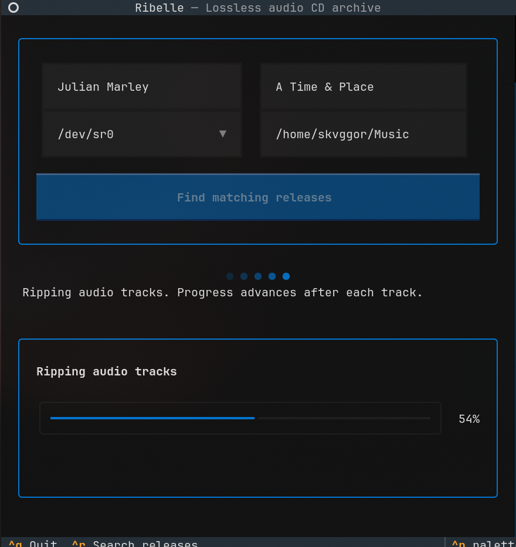

# Ribelle

Back up audio CDs as lossless FLAC files with metadata from MusicBrainz.

## Requirements

- Python 3.12 or newer and [uv](https://docs.astral.sh/uv/)
- `cdparanoia` and `flac` on `PATH` (Arch Linux: `sudo pacman -S cdparanoia flac`)
- An internet connection for MusicBrainz lookups

## Usage

Start Ribelle to open its terminal interface, or pass an artist and album to begin the
lookup immediately:

```sh
uv run ribelle
uv run ribelle --artist "Artist Name" --album "Album Title"
```

Ribelle detects optical drives, matches release editions to the CD's track count, and starts
automatically when there is only one match. When several editions fit, choose one in the
TUI. Tagged FLAC files are saved under `~/Music/Artist Name/Album Title/`; existing files
are never overwritten. Use `--device /dev/sr1` to preselect a drive or
`--output /path/to/music` to change the destination. `--high-contrast` selects the ANSI
theme, and `--reduced-motion` disables animated loading indicators. MusicBrainz outages
are retried with the server's `Retry-After` delay. Set `RIBELLE_REDUCED_MOTION=1` to keep
loading feedback static by default.

## Screenshot



## Development

```sh
uv sync --all-groups
uv run pytest
uv run ruff check .
uv run ruff format --check .
uv run ty check
uv audit --locked
uv run sonar
```

The test run enables branch coverage and fails below 80% total coverage. Check the report
for each changed module as well; a strong aggregate must not hide an untested file.

`uv run sonar` starts a short-lived, locally bound SonarQube server and runs the analysis
with pinned container digests. Set `SONAR_KEEP_ALIVE=1` to leave the server available at
`http://127.0.0.1:9000` for inspection.

## Architecture

- `domain` contains validated album and track metadata.
- `application` defines catalog and ripping boundaries and coordinates the rip workflow.
- `infrastructure` adapts MusicBrainz, `cdparanoia`, FLAC encoding, and Mutagen tagging.
- `presentation` contains the Textual screens and interactive workflow.
- `cli` parses command-line options and wires the adapters into the TUI.

Network and system-tool boundaries are replaced with typed fakes in unit tests, so the
test suite does not need an internet connection or a CD drive.

## License

Ribelle is distributed under the GNU General Public License, version 3. See [LICENSE](LICENSE).
